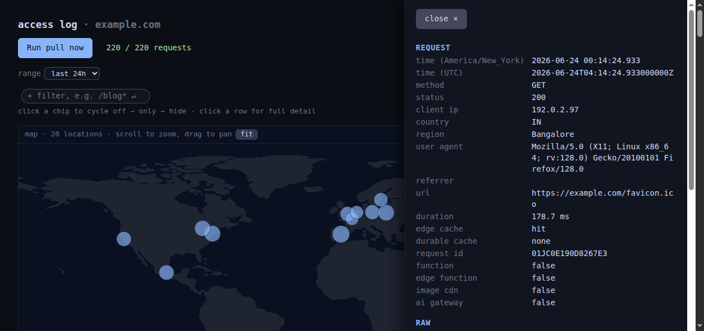
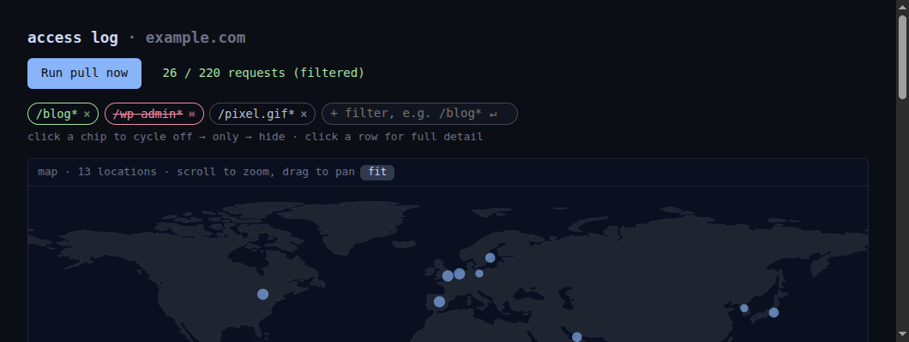

# netlify-logs

A small script to pull your own Netlify access logs and keep them locally in SQLite, with a tiny dashboard to look at them. Run `./netlify-logs.py -h` (and
`pull -h` / `serve -h`) for the full set of options.


<sub>Screenshots use synthetic demo data (`example.com`, documentation-range IPs).</sub>

## Setup

```sh
npm install -g netlify-cli   # or use: npx netlify-cli
netlify login
export NETLIFY_SITE_ID=<your-site-id>   # Site configuration -> Site information
./install.sh
```

`install.sh` adds two user systemd units: a pull every 15 minutes, and the
dashboard on `127.0.0.1:8800`. Requests are stored in `logs/access.db` (SQLite,
stdlib), deduped by `request_id`. An existing `logs/access.ndjson` is imported
automatically on first run — or do it explicitly with
`./netlify-logs.py import <file>`.

## Dashboard

- **Date range** — last 1h / 24h / 7d / 30d, custom, or all (queried server-side).
- **World map** of request origins (zoom, pan, `fit`).
- **Entry detail** drawer — click any row or pin for the full record.
- **Filter chips** — click to cycle off → only → hide; add your own URL globs.
- **Run now** — pull on demand and refresh.

| entry detail | filter chips |
|---|---|
|  |  |
