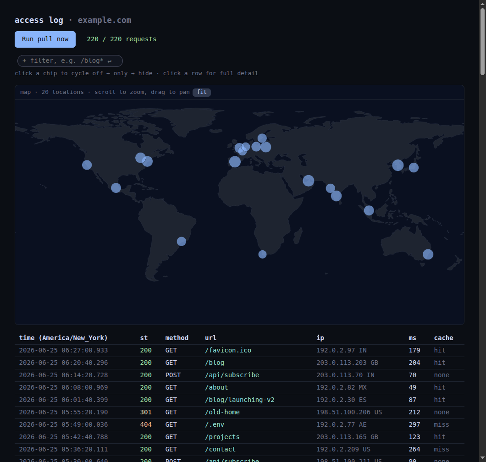

# netlify-logs

A small script to pull your own Netlify traffic logs into a local SQLite, with a tiny dashboard to look at them. Single file, Python stdlib only, no dependencies. Run `./netlify-logs.py -h`, `pull -h`, or `serve -h` for the full set of options.



## Heads up

This reads your site's traffic logs through the same internal endpoint Netlify's
own dashboard uses. There's no public API for it, so:

- It's **unofficial and not affiliated with Netlify**, and it can break whenever
  they change that endpoint
- It's for **your own logs on your own account**, nothing else
- Using it may violate Netlify's terms of service
- Use at your own risk
- Keep paying for Netlify

## Setup

```sh
npm install -g netlify-cli   # or use: npx netlify-cli
netlify login
export NETLIFY_SITE_ID=<your-site-id>   # Site configuration -> Site information
./install.sh
```

`install.sh` adds two user systemd units: a pull every 15 minutes, and the
dashboard on `127.0.0.1:8800`. Behind a reverse proxy that forwards the
original Host header, install with `NETLIFY_LOGS_ALLOW_HOST=<name>`. Requests
are stored in `logs/access.db`, a stdlib SQLite database, deduped by
`request_id`.

## License

MIT. The world outline in `world.json` is generated from
[Natural Earth](https://www.naturalearthdata.com/) 110m land data (public domain).
